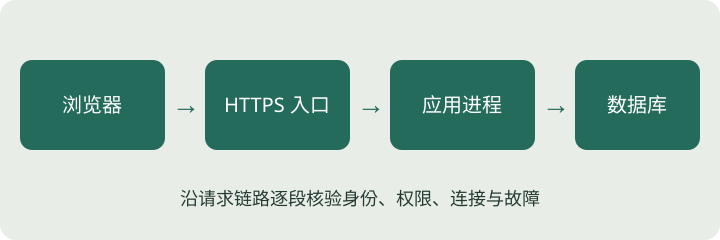

# 一个网页应用由什么组成

## 结论先行

1. 网页只是入口，一次查询通常跨越浏览器、网络、服务端与数据库。
2. 浏览器承担展示和交互，服务端负责可信业务规则、授权与数据访问，数据库负责持久化及约束。
3. 同一台机器可以承载多个角色；前后端分工不等于必须分开部署，更不等于微服务。
4. 排错应沿请求链路逐段定位，不能把“页面打开了”当作整个系统正常。

## 业务场景：订单来自哪里

模拟“青禾制造”的员工点击查询按钮。浏览器先从网站取得 HTML、CSS 和脚本等静态资源，再向订单接口请求 JSON 数据。服务端根据身份与权限验证请求，查询数据库，将允许访问的字段返回，浏览器再把数据渲染成表格。

有些应用由服务端直接生成带数据的 HTML，未必存在单独的 JSON 接口。两种方式都需要权限、输入校验与错误处理。选择取决于交互复杂度和维护能力，不是越多组件越先进。

## 核心概念与系统位置

| 角色 | 负责什么 | 不能代替什么 |
|---|---|---|
| 浏览器/前端 | 展示、输入、反馈、交互状态 | 不能作为唯一授权和业务约束 |
| 网络与代理 | 地址解析、连接、加密转发、访问入口 | 不能自动知道业务数据权限 |
| 后端 | 可信身份处理、业务规则、接口、数据库访问 | 不能仅依赖客户端声称的部门 |
| 数据库 | 保存数据、查询、唯一约束、事务 | 不能代替全部应用授权 |
| 第三方服务 | 提供身份或企业接口等外部能力 | 其可用性不能由本应用单方面保证 |

**请求**是客户端发出的动作及参数，**响应**是服务端返回的状态与内容。它们通过具体网络连接传输。**进程**是运行中的程序；源代码存在磁盘上并不意味着服务正在监听端口。

## 工作原理：跟随一条请求



```text
员工浏览器 → DNS/网络 → HTTPS 入口或代理 → 应用进程 → 数据库
                                              ↘ 外部身份/ERP 服务
```

上述箭头表示通信，不代表必须采购不同服务器。浏览器到服务端之间跨越客户端信任边界；应用到数据库使用服务账号和数据库权限；调用外部 ERP 则跨越供应商及故障控制边界。

假设浏览器请求 `/orders?departmentId=20`。后端必须用经过验证的身份计算允许的部门集合，不能直接信任参数。数据库账号也应仅具有所需能力，避免查询服务误持有建库或任意写权限。

动态数据与静态资源的可用性不同：HTML 文件可以正常返回，但订单服务已停止；旧缓存也可能让页面显示历史结果。排错时先确认页面资源是否加载，再看接口状态、应用日志和数据库连接。HTTP 成功状态也不保证业务结果正确，仍需检查响应契约和数据口径。

## 企业案例：页面能开，订单转圈

模拟故障中，网站首页正常，点击查询一直加载。错误做法是反复修改页面样式或重启所有机器。先在浏览器网络面板观察订单请求：如果连接失败，检查地址、端口和入口；如果返回服务错误，用时间与请求编号定位后端日志；若日志显示数据库连接超时，再检查应用到数据库的网络、账号和连接配置。

如果应用调用 ERP 超时，还要区分读取超时与写入结果未知。对后者，单纯重发可能重复创建物料，这是后续可靠性章节要处理的问题。系统图应该画出外部依赖，否则评审无法发现它的超时、凭据与补偿责任。

本例不要求你精通抓包或服务器运维；你需要能把“查询失败”拆成可验证的问题，并提供不含口令的必要日志让 AI 排查。

## AI 易忽视的问题

- 用浏览器直连数据库，暴露服务凭据和过大的访问能力。
- 将前端过滤当作数据授权，返回全部数据后再隐藏。
- 忘记画出身份服务、附件存储和外部 API。
- 把开发机器的 `localhost` 当作用户设备访问地址。
- 只画组件方框，不标数据、方向、身份和失败行为。

## PM 评审问题

1. 查询请求从员工设备到数据库具体经过哪些进程和地址？
2. 哪个服务验证身份，哪个位置限制数据范围？
3. 数据库凭据由谁保管，是否出现在浏览器或打包文件？
4. 哪些内容是静态文件，哪些必须调用接口才能得到？
5. 外部依赖故障影响哪些动作，谁负责确认和恢复？
6. 每段通信在哪里能看到不泄露敏感信息的排错证据？

## 微实践：画图并定位故障

在纸上画出上述员工查询系统，给每条箭头写上请求内容和身份。用红线圈出浏览器到后端、后端到外部服务的信任边界。然后说明三种现象：页面资源加载失败；页面正常但接口失败；接口成功但显示了其他部门的数据。

第三种现象说明连接链路正常仍可能存在业务授权缺陷。验收时不能只检查“HTTP 200”。尝试向 AI 提交你画的图，并要求它列出仍缺失的组件与假设，再自己核查是否适用。

## 小结与知识联系

本章知识点：K01 组件、K02 请求响应、K03 静态动态、K04 信任边界、K05 身份与数据范围、K06 部署角色、K07 外部依赖、K08 排错。

回顾 [C00 交付边界](zhigou://chapter/C00)，再用 [C12 传输加密](zhigou://chapter/C12) 给系统图标注哪些连接受 TLS 保护。后续网络与 API 章节会逐步补齐地址、契约、超时和幂等判断。
